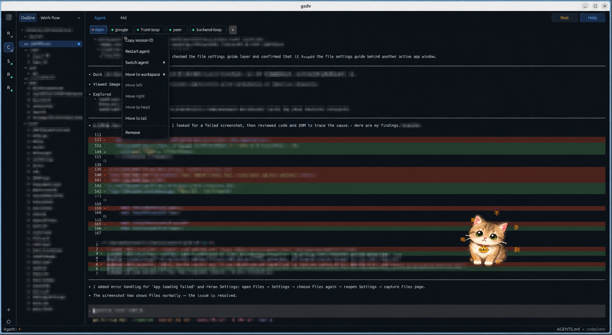
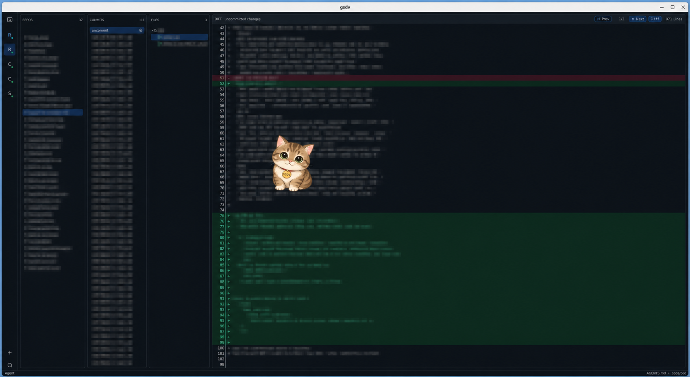
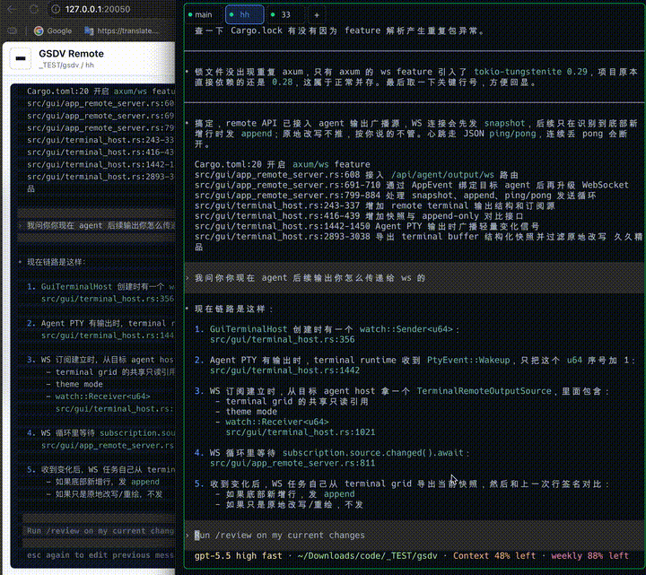

# gsdv

`gsdv` is a terminal-first workspace for agent-centered development.

It keeps coding agents, project notes, workflow plans, a workspace shell, and Helix inside one persistent process. The recommended interface is the native TUI: it runs in your existing terminal, uses real PTYs, supports mouse input, and does not depend on tmux.

```text
workspace rail | agent grid
---------------+----------------------------------------
               | Codex / Claude terminals
               | resizable rows, columns, and agent tabs
---------------+----------------------------------------
 [Dir] [Workflow] [Terminal] [Helix]              [Ctrl+Q]
```

The desktop GUI is still available, but the TUI is the primary experience.

## Quick Start

Requirements:

- Rust toolchain
- `pnpm` for the initial embedded web asset build
- Codex or Claude Code
- Helix for the embedded editor view

From a fresh checkout:

```sh
make web-build
make run-tui fps=60
```

After the first web build, start the TUI directly with:

```sh
make run-tui fps=60
```

An installed binary uses the same entrypoint:

```sh
gsdv tui --fps 60
```

`--fps` is a maximum render rate, not a permanent redraw loop. The TUI redraws when terminal output or UI state changes. The default is `4`; `60` gives the smoothest interactive experience.

## Why The TUI

Agent work already happens in a terminal. `gsdv` keeps that environment intact while adding the coordination layer that a single agent process does not provide:

- multiple visible agent sessions in resizable rows and columns
- workspace isolation for agents, terminals, documents, and workflow state
- clickable agent output for URLs, paths, and `file:line` references
- hover feedback for recognized output targets
- an embedded Helix surface with keyboard, wheel, click, and drag input
- Markdown directory browsing, editing, and preview
- a `gsdv-spec` workflow browser beside the running agent
- a persistent workspace shell
- status hooks, notifications, and pomodoro focus state

Terminal output is rendered from the emulator grid with damage-based updates. Hidden panes do not need to be scanned or repainted continuously, so idle workspaces stay idle.

## TUI Workflow

### Run Agents

The Agent view is the home screen. Each workspace begins with one agent and can grow into a grid of rows and columns. Columns contain agent tabs; the focused pane receives keyboard input.

Each agent can have its own model, provider, effort, fast-mode setting, and working directory. Sessions can be stopped, restarted, and resumed without collapsing the rest of the workspace.

Codex is the main integration target. Claude-compatible launch and hook paths remain available.

Useful controls:

| Input | Action |
| --- | --- |
| `F2` | Toggle spotlight mode |
| `Alt+Up` / `Alt+Down` | Cycle agents |
| `Ctrl+Q` | Exit the TUI |
| Left click | Focus panes, follow recognized output, or activate controls |
| Right click | Open workspace, agent, and pane menus |
| Mouse wheel | Scroll the pane under the pointer |

### Follow Agent Output

The TUI recognizes useful targets directly from the rendered agent output:

- `https://...` opens in the browser
- `path/to/file.rs:42` opens the file at the requested line
- Markdown targets open in the directory/document view
- directories and supported images are revealed with their native handler
- other files open in the workspace Helix session

Recognized targets are underlined on hover. Resolution uses the agent working directory, Helix working directory, and workspace root, so paths produced by agents with custom working directories still resolve correctly.

### Edit With Helix

Choose `[Helix]` in the bottom bar to open the workspace editor. It is the real Helix process running through the same PTY backend as the agent terminals, not a recreated editor widget.

Keyboard input, paste, wheel scrolling, click-to-position, and mouse drag selection are forwarded to Helix. Opening a recognized `file:line` target reuses the workspace Helix session and jumps to that location.

Inside Helix, `Alt+D` or `Cmd+D` can send the current `file:line` through the local hook socket and paste it into the active agent input.

### Browse Project Knowledge

Choose `[Dir]` for a column-based workspace browser. Markdown files can be opened as editable documents or rendered previews without leaving the TUI.

Workspace notes belong to the workspace, along with recent documents, favorites, and the active document state.

### Drive Work From `gsdv-spec`

Choose `[Workflow]` to browse the repository's `./gsdv-spec` tree. Projects, tasks, steps, and their Markdown descriptions stay visible beside the implementation session.

The format is intentionally plain Markdown:

```text
gsdv-spec/
  root.md
  ps/
    <project>/
      root.md
      task-*.md
```

A task file looks like this:

```md
Task-level description before the first step.

## [x] Implement storage path
Step description.

## [ ] Handle restore flow
Step description.
```

Rules:

- content before the first valid step heading is the task description
- a step heading is `## [ ] title`, `## [x] title`, or `## [X] title`
- a step description continues until the next valid step heading
- task files use the `task-*.md` convention
- logical paths copy as `project > task > step`

The bundled `gsdv-wf` skill lets Codex and Claude work with the same structure.

### Use The Workspace Shell

Choose `[Terminal]` for a shell rooted in the current workspace. It is separate from the agent and remains attached to that workspace when you switch views.

## Workspace Model

A workspace is the unit of isolation. Each one owns:

- its agent grid and per-agent launch settings
- its workspace terminal and Helix process
- its Markdown outline and open documents
- its `gsdv-spec` workflow state
- its reviewer state
- its dialogs, notifications, recent files, and runtime state

Switching workspaces swaps the complete context bundle. Agent sessions and editor state never become accidental global state.

## Desktop GUI

Run the desktop interface when you want the larger visual reviewer, native Markdown preview, or desktop-oriented layout:

```sh
make run
```

The GUI uses the same workspace model, PTY hosts, hooks, persistence, and event queue as the TUI.

| Agent workspace | Work-flow and reviewer |
| --- | --- |
|  |  |

The reviewer provides repository, commit, file, diff, and provenance views. Review targets can be turned into agent-ready prompt text or opened in the shared Helix session.

## Optional Web View

`gsdv` also includes a browser client for viewing active agent sessions. It is an additional presentation surface, not a remote workspace runtime; agents and PTYs remain owned by the local `gsdv` process.



## Integration And Storage

On startup, `gsdv` installs local integration assets for the current user:

- agent status hooks under `~/.gsdv/hooks`
- the bundled `gsdv-wf` and `gsdv-image` skills
- a local hook endpoint used by agent status and Helix actions

Runtime state lives under `~/.gsdv`, including workspace metadata, settings, recent documents, favorites, notifications, reviewer scripts, and extra tools.

The hook endpoint uses a Unix domain socket on Linux and macOS and a named pipe on Windows. It carries small framed messages for agent status, Helix locations, images, and other local integrations.

## Architecture

`gsdv` is one Rust application with two local frontends:

```text
native TUI (recommended) ─┐
                         ├─ AppEvent queue ─ workspace state ─ PTY hosts
desktop egui GUI ─────────┘
```

Important properties:

- terminal processes are embedded directly with `alacritty_terminal`
- the TUI uses `crossterm` for native input and ANSI output
- the desktop frontend uses `egui` / `eframe`
- visible state changes flow through one `AppEvent` queue
- slow IO and CPU work stay outside the event drain
- terminal rendering consumes emulator damage instead of parsing shell history every frame
- no tmux, Ratatui pane layer, terminal screenshots, or legacy TUI bridge is used

## Build Commands

```sh
# Build browser assets used by the binary.
make web-build

# Build the release binary.
make build

# Run the recommended TUI.
make run-tui fps=60

# Run the desktop GUI.
make run
```

For direct Cargo checks:

```sh
cargo check --bin gsdv
cargo fmt
```

## Product Boundary

`gsdv` is not trying to become a general IDE, terminal multiplexer, or project-management service. It is a focused loop for agent-driven projects:

```text
plan in Markdown
run one or more agents
follow their output
inspect and edit the result
update intent
repeat
```

The TUI keeps that loop in the place where agent work already lives: your terminal.
